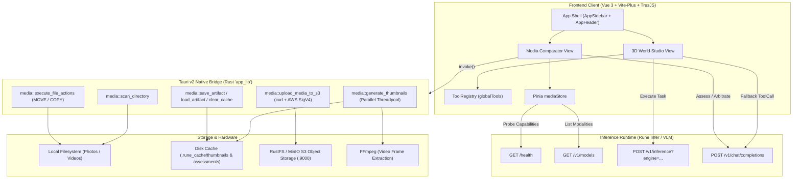

<p align="center">
  <picture>
    <source media="(prefers-color-scheme: dark)" srcset="https://raw.githubusercontent.com/shba007/rune-studio/main/public/logo.svg">
    
  </picture>
</p>

<h1 align="center">Rune Studio</h1>

<p align="center">
  <strong>Multimodal AI Workflow Harness & 3D Agentic Studio for Rune Kit & Rune Infer</strong>
</p>

<p align="center">
  <a href="https://github.com/shba007/rune-studio/actions/workflows/deploy.yml"></a>
  <a href="https://github.com/shba007/rune-studio/blob/main/LICENSE"></a>
  <a href="https://tauri.app/"></a>
  <a href="https://vuejs.org/"></a>
  <a href="https://bun.sh/"></a>
  <a href="https://www.rust-lang.org/"></a>
  <a href="https://github.com/voidzero-dev"></a>
</p>

---

## Overview

**Rune Studio** is an extensible desktop GUI and multimodal AI workflow harness designed for **Rune Kit / Tools** and **Rune Infer**. It bridges ComfyUI-style generative asset pipelines (dual-image VLM forensic arbitration, continuous fidelity ranking, and star clustering) with modern agentic execution harnesses (3D spatial interactive studio, LLM tool calling, and MCP/skill extensible orchestration).

Engineered on **Tauri v2**, **Vue 3**, **Three.js / TresJS**, and **Rust**, Rune Studio operates entirely locally with zero telemetry, fast disk caching in `.rune_cache`, and optional local S3/RustFS streaming.

### Key Capabilities

- 🧠 **Dual-Engine VLM Arbitration & Deduplication**: Automated side-by-side forensic image and video analysis across 4 evaluation intents (biometrics, product models, exact/near deduplication, and scene themes).
- 🔬 **Quality-Gated Multi-Exemplar Star Clustering**: Continuous forensic fidelity scoring (0.0 to 10.0) that filters occluded or blurred captures and clusters assets into coherent identity groups in $O(N \cdot K)$ time.
- 🌐 **3D Spatial Agent Simulation Studio**: Interactive Three.js/TresJS canvas with dynamic physical elements (monitor, printer, chair, lighting) driven by real-time LLM function calling and tool dispatch.
- ⚡ **High-Throughput Native Rust IPC**: Multi-threaded thumbnail generation (parallel JPEG scaling + FFmpeg video keyframe extraction), recursive directory walking, and non-destructive batch file operations.
- 🗄️ **Local Disk Cache & S3 Streaming**: Zero-cloud dependency caching in `.rune_cache` with optional AWS SigV4 curl uploads to local MinIO/RustFS or remote S3 buckets.
- 🖥️ **Cross-Platform Target Architecture**: Native desktop execution for Windows, macOS (Apple Silicon & Intel), and Linux, with containerized Docker web deployment and Android mobile builds.

---

## System Architecture



---

## Workspaces

### 1. Media Comparator & Forensic Profiler

Accessible at `/media-comparator`. Designed for high-volume visual dataset organization, biometric clustering, and duplicate pruning.

#### Comparison Intent Presets

| Intent Key      | Label                  | Badge                | Evaluation Strategy                                                                                                                                                                                                                 |
| --------------- | ---------------------- | -------------------- | ----------------------------------------------------------------------------------------------------------------------------------------------------------------------------------------------------------------------------------- |
| `same_person`   | Identity / Person      | `👤 Face & Identity` | Examines invariant anatomical landmarks: craniofacial bone structure, interpupillary distance ratio, ear shape/lobule attachment, nasal root/bridge profile. Strictly ignores clothing, hair changes, accessories, and backgrounds. |
| `same_product`  | Product / Item         | `📦 Product Model`   | Forensic product verification analyzing silhouette geometry, edge contours, seams, hardware, logos, and materials, ignoring the wearer or scene setting.                                                                            |
| `duplicates`    | Near / Exact Duplicate | `📑 Deduplication`   | Photographic deduplication analyzing framing, camera angle, subject pose, and composition.                                                                                                                                          |
| `same_category` | Theme / Category       | `🎨 Scene Theme`     | Visual scene and environmental context classification evaluating lighting ambiance and scene category.                                                                                                                              |

#### Forensic Fidelity Scoring Formula ($0.0 - 10.0$)

Before clustering, each media item is evaluated using a continuous multi-factor fidelity metric (`calculateFidelityScore`):

$$\text{Score} = \text{Resolution} + \text{Illumination} + \text{Occlusion} + \text{MotionBlur} + \text{AngleBonus}$$

- **Resolution (Max 3.0 pts)**: `high` (+3.0) | `medium` (+2.0) | `low` (+1.0)
- **Illumination (Max 2.5 pts)**: `uniform` (+2.5) | `side_shadow` (+1.8) | `backlit` (+1.2) | `dim`/`harsh` (+0.8)
- **Occlusion (Max 2.5 pts)**: `none` (+2.5) | `partial_under_25` (+1.5) | `heavy_under_60` (+0.5) | `severe_over_60` (0.0)
- **Motion Blur (Max 1.0 pt)**: `none` (+1.0) | `slight` (+0.5) | `severe` (+0.1)
- **Angle Bonus (Max 1.0 pt)**: `frontal` (+1.0) | `three_quarter` (+0.8) | `profile` (+0.4) | `unobservable`/other (+0.1)

> **Exemplar Qualification**: Items with $\text{Score} \ge 8.0$ are classified as **Optimal Anchor Candidates**. Only assets with $\text{Score} \ge 7.0$ presenting complementary unobserved angles are promoted to a cluster's exemplar pool (up to 3 exemplars per cluster).

#### Quality-Gated Multi-Exemplar Star Clustering

1. **Sort Assets**: Candidate assets are sorted by `fidelityScore` descending so degraded captures never seed clusters.
2. **Probing ($O(N \cdot K)$)**: Candidate is tested against exemplar pools of existing clusters via direct side-by-side VLM arbitration.
3. **Boundary Reconciliation ($O(K^2)$)**: Boundary clusters are merged if secondary exemplars confirm identity match.
4. **Safe Staging**: Duplicates and clusters are reviewed in `StagedActionsModal` before any physical file move occurs. Collisions are automatically avoided with numeric suffixes (`_1`, `_2`).

---

### 2. 3D World Studio & AI Tool Registry

Accessible at `/studio`. Provides an interactive spatial 3D viewport powered by `@tresjs/core` and `three` where physical entities respond to AI function calls in real time.

#### Registered AI Tools (`ToolRegistry`)

The `globalTools` singleton normalizes, validates, and dispatches LLM tool calls with fuzzy name and alias resolution:

| Tool Name            | Aliases                                                                                    | Parameters Schema                              | Action Performed                                                                                                        |
| -------------------- | ------------------------------------------------------------------------------------------ | ---------------------------------------------- | ----------------------------------------------------------------------------------------------------------------------- |
| `print_document`     | `print`, `printer_print`, `start_print`                                                    | `{ document_name?: string, copies?: number }`  | Triggers 3D printer animation, ejects paper plane (+0.35 Y), activates status indicator light.                          |
| `scan_document`      | `scan`, `printer_scan`, `start_scan`                                                       | `{ target?: string }`                          | Triggers scanner illumination sequence (2.5s duration).                                                                 |
| `set_room_lighting`  | `toggle_room_lights`, `set_ambient_light`, `room_lights`                                   | `{ state: "on" \| "off", intensity?: number }` | Toggles ambient/directional Three.js lighting and adjusts dynamic intensity ($0.1 - 2.0$).                              |
| `rotate_chair`       | `rotate_item`, `turn_chair`                                                                | `{ degrees?: number }`                         | Rotates desk chair mesh around the Y-axis by specified degrees (default `45°`).                                         |
| `set_monitor_power`  | `toggle_monitor`, `turn_on_monitor`, `turn_off_monitor`, `power_monitor`, `set_pc_power`   | `{ state: "on" \| "off" }` _(required)_        | Switches PC monitor screen mesh emissive illumination on/off.                                                           |
| `set_screen_display` | `set_screen_theme`, `display_on_monitor`, `change_wallpaper`, `open_editor`, `matrix_mode` | `{ theme: string }` _(required)_               | Updates PC monitor emissive theme (`code`, `matrix`, `terminal`, `cyberpunk`, `blue`, `white`, `amber`, or custom hex). |

---

## Tauri IPC Command Reference (Rust Backend)

All commands are defined in `src-tauri/src/media.rs` and bound via `tauri::generate_handler!`:

| Command Name                | Input Arguments                                                              | Return Type                             | Implementation Details                                                                                                                                                                                                                         |
| --------------------------- | ---------------------------------------------------------------------------- | --------------------------------------- | ---------------------------------------------------------------------------------------------------------------------------------------------------------------------------------------------------------------------------------------------- |
| `pick_directory`            | _(none)_                                                                     | `Result<Option<String>, String>`        | Launches native async directory picker dialog via `rfd::AsyncFileDialog`. Returns absolute path or `None`.                                                                                                                                     |
| `scan_directory`            | `path: String`, `recursive: bool`                                            | `Result<Vec<MediaItemPayload>, String>` | Recursively or shallowly traverses folder with `walkdir`. Filters hidden entries. Supports images (`jpg`, `jpeg`, `png`, `webp`, `gif`, `bmp`, `avif`) and videos (`mp4`, `webm`, `mov`, `mkv`). Checks for existing `.rune_cache/thumbnails`. |
| `generate_thumbnails`       | `items: Vec<MediaItemPayload>`, `folder_path: String`                        | `Result<Vec<ThumbnailResult>, String>`  | Multi-threaded worker pool (bounded between 4 and 8 threads). Generates 360x360 JPEG thumbnails. For videos, invokes `ffmpeg` with `-ss 00:00:01` (fallback `00:00:00`). Saves to `.rune_cache/thumbnails/{size}_{modified}.jpg`.              |
| `get_media_base64`          | `path: String`                                                               | `Result<String, String>`                | Reads file from disk, detects MIME type, and returns `data:<mime>;base64,<base64_data>`.                                                                                                                                                       |
| `upload_media_to_s3`        | `file_path: String`, `bucket_url: String`                                    | `Result<String, String>`                | Invokes system `curl` with AWS SigV4 authentication (`--aws-sigv4 aws:amz:<region>:s3`, `--user <key>:<secret>`). Falls back to unauthenticated upload for local emulators. Returns object URL.                                                |
| `execute_file_actions`      | `actions: Vec<FileActionRequest>`                                            | `Result<ActionResultPayload, String>`   | Executes batch file operations (`MOVE` or `COPY`). Automatically creates destination directories and resolves name collisions by appending `_1`, `_2`, etc. Returns `{ successCount, errors }`.                                                |
| `save_artifact_to_disk`     | `folder_path: String`, `file_hash: String`, `intent: String`, `data: String` | `Result<(), String>`                    | Persists JSON evaluation artifact to `<folder>/.rune_cache/assessments/<hash>.<intent>.json`.                                                                                                                                                  |
| `load_artifact_from_disk`   | `folder_path: String`, `file_hash: String`, `intent: String`                 | `Result<Option<String>, String>`        | Reads cached JSON assessment from disk. Returns `None` if file does not exist.                                                                                                                                                                 |
| `clear_directory_cache`     | `folder_path: String`                                                        | `Result<(), String>`                    | Recursively purges the entire `<folder>/.rune_cache` directory.                                                                                                                                                                                |
| `delete_artifact_from_disk` | `folder_path: String`, `file_hash: String`, `intent: String`                 | `Result<(), String>`                    | Deletes a single evaluation artifact file from `.rune_cache/assessments/`.                                                                                                                                                                     |

---

## Inference & Network Protocol

Rune Studio interfaces with **Rune Infer** or any OpenAI-compatible multimodal endpoint:

```
VITE_AI_API_URL (default: http://localhost:3423)
├── GET  /health                        -> Probes server status, version, and loaded_models
├── GET  /v1/models                     -> Queries model IDs and checks capabilities.vision
├── POST /v1/inference?engine=<model>   -> Direct fast tool-call execution
└── POST /v1/chat/completions           -> OpenAI-compatible tool calling and multimodal VLM arbitration
```

### Thinking Mode Configuration

Configurable via the top header bar:

- **Strict Mode** (`0.2` Temperature): Low hallucination, deterministic JSON extraction for categorization and arbitration.
- **Deep Mode** (`0.6` Temperature): Extended reasoning and detailed visual landmark profiling with `<think>` tag stripping.

---

## Configuration & Environment Variables

Create a `.env` file in the project root:

```env
# URL of Rune Infer or OpenAI-compatible VLM server
VITE_AI_API_URL=http://localhost:3423

# S3 / MinIO / RustFS Object Storage endpoint
VITE_S3_BUCKET_URL=http://localhost:9000/videos

# S3 Authentication Credentials (used by curl SigV4 in Rust backend)
S3_ACCESS_KEY=rustfsadmin
S3_SECRET_KEY=rustfsadmin
S3_REGION=us-east-1
S3_BUCKET=videos
```

---

## Development Workflow

### Prerequisites

- **Bun**: `^1.2.9` (pinned to `bun@1.4.3`)
- **Node.js**: `^22.18.0 || ^24.11.0 || >=26.0.0`
- **Rust Toolchain**: `1.98.1+` (2024 edition) with `cargo`
- **FFmpeg**: Required in system `PATH` for video thumbnail extraction
- **OS Libraries (Linux only)**: `libwebkit2gtk-4.1-dev`, `libappindicator3-dev`, `librsvg2-dev`, `patchelf`

### Installation

```bash
# Clone the repository
git clone https://github.com/shba007/rune-studio.git
cd rune-studio

# Install dependencies using Bun
bun install --frozen-lockfile
```

<details>
<summary><strong>Manifest Scripts Reference</strong></summary>

| Script                       | Command                         | Description                                                         |
| ---------------------------- | ------------------------------- | ------------------------------------------------------------------- |
| `bun run dev`                | `vp dev`                        | Launches Vite-Plus dev server on `http://localhost:5173`.           |
| `bun run tauri:dev`          | `tauri dev`                     | Launches full native Tauri desktop application in development mode. |
| `bun run build`              | `vp build`                      | Bundles web production assets into `dist/`.                         |
| `bun run preview`            | `vp preview`                    | Previews production web build locally.                              |
| `bun run lint`               | `vp lint . --fix`               | Runs oxlint linter across workspace with automatic fixes.           |
| `bun run format`             | `vp fmt src/`                   | Runs Vite-Plus code formatter on `src/`.                            |
| `bun run test:unit`          | `vp test`                       | Runs unit tests using Vitest and jsdom.                             |
| `bun run detect`             | `gitleaks git --verbose`        | Scans git history for exposed credentials or secrets.               |
| `bun run clean`              | `(cd src-tauri && cargo clean)` | Removes Rust build artifacts.                                       |
| `bun run tauri:build`        | `tauri build`                   | Compiles native desktop production installers/binaries.             |
| `bun run tauri:dev:mobile`   | `tauri android dev`             | Starts Android emulator development.                                |
| `bun run tauri:build:mobile` | `tauri android build`           | Compiles Android universal APK and AAB packages.                    |

</details>

---

## Build & Distribution

### 1. Native Desktop Bundles

```bash
# Builds desktop bundle for your current operating system
bun run tauri:build
```

Outputs installer artifacts in `src-tauri/target/release/bundle/` (`.msi`/`.exe` on Windows, `.dmg`/`.app` on macOS, `.deb`/`.AppImage` on Linux).

### 2. Android Mobile Build

Ensure `ANDROID_HOME` and `NDK_HOME` (NDK `29.0.13846066`) are exported:

```bash
bun run tauri:build:mobile
```

Outputs:

- APK: `src-tauri/gen/android/app/build/outputs/apk/universal/release/app-universal-release.apk`
- AAB: `src-tauri/gen/android/app/build/outputs/bundle/universalRelease/app-universal-release.aab`

### 3. Containerized Web Build (Docker)

```bash
docker build -t rune-studio:latest .
docker run -d -p 8080:8080 --name rune-studio rune-studio:latest
```

---

## CI/CD Pipeline & Secrets

The repository includes a multi-platform GitHub Actions workflow (`.github/workflows/deploy.yml`) triggering on published releases:

- **Web Container**: Builds multi-arch Docker image and pushes to `ghcr.io/shba007/rune-studio` with build provenance attestations.
- **Desktop Matrix**: Builds on `windows-latest`, `ubuntu-latest`, and `macos-latest` (both `x86_64` and `aarch64`).
- **Android Matrix**: Compiles universal `.apk` and `.aab` artifacts.

A separate workflow (`.github/workflows/rust.yml`, on pull requests and pushes to `develop` and `main`) runs `cargo test --lib` with and without `--features agent-bridge` on `windows-latest` and `ubuntu-latest`. Clippy and `cargo fmt --check` run too but do not fail the build yet.

### Required Repository Secrets & Variables

| Secret / Variable                            | Scope         | Description                                                   |
| -------------------------------------------- | ------------- | ------------------------------------------------------------- |
| `vars.USERNAME`                              | Repo Variable | GitHub container registry username                            |
| `vars.SITE_URL`                              | Repo Variable | Target deployed URL                                           |
| `secrets.TAURI_SIGNING_PRIVATE_KEY`          | Repo Secret   | Private key for Tauri auto-updater artifacts (`.key`)         |
| `secrets.TAURI_SIGNING_PRIVATE_KEY_PASSWORD` | Repo Secret   | Password for the updater signing private key                  |
| `secrets.ANDROID_KEY_BASE64`                 | Repo Secret   | Base64-encoded `release-keystore.jks` for Android APK signing |
| `secrets.ANDROID_KEY_ALIAS`                  | Repo Secret   | Alias name in the Android keystore (`release-key`)            |
| `secrets.ANDROID_KEY_PASSWORD`               | Repo Secret   | Password for the Android signing key                          |

---

## License

Published under the [MIT](https://github.com/shba007/rune-studio/blob/main/LICENSE) License.  
Copyright &copy; 2024 Shirsendu Bairagi.

<br>

<a href="https://github.com/shba007/rune-studio/graphs/contributors">
  
</a>