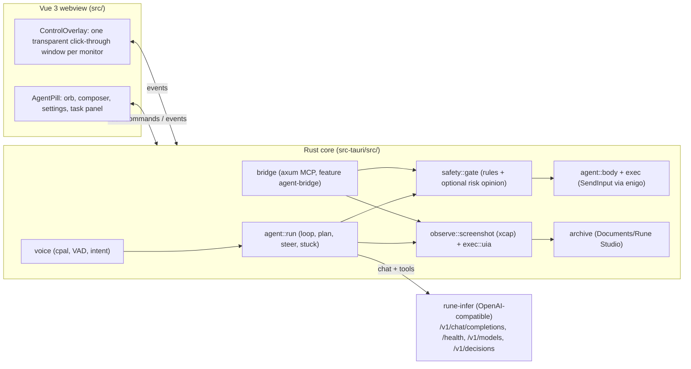

<p align="center">
  <picture>
    <source media="(prefers-color-scheme: dark)" srcset="https://raw.githubusercontent.com/shba007/rune-studio/main/public/logo.svg">
    
  </picture>
</p>

<h1 align="center">Rune Studio</h1>

<p align="center">
  <strong>A voice and text driven desktop harness that controls your PC through a local model server (rune-infer)</strong>
</p>

<p align="center">
  <a href="https://github.com/shba007/rune-studio/actions/workflows/deploy.yml"></a>
  <a href="https://github.com/shba007/rune-studio/blob/main/LICENSE"></a>
  <a href="https://tauri.app/"></a>
  <a href="https://vuejs.org/"></a>
  <a href="https://bun.sh/"></a>
  <a href="https://www.rust-lang.org/"></a>
  <a href="https://github.com/voidzero-dev"></a>
</p>

---

## Overview

Rune Studio is a small floating desktop app. You give it a command by typing or speaking, and it carries the command out on your PC: it looks at the screen, picks **one** action, performs it with the real mouse and keyboard, checks the result and repeats until the task is done.

- **Windows 11 is the supported platform.** Screen capture, input, UI Automation, app launching, foreground-window detection and the pointer effects are implemented for Windows only. The release workflow also builds macOS and Linux bundles, but on those systems the Windows-only parts are empty stubs (see [Platform support](#platform-support)).
- **All AI inference goes to rune-infer**, a local OpenAI-compatible model server that you run yourself. The app never talks to a cloud model directly.
- **The model only proposes actions.** Nothing reaches the OS except through the [safety gate](#safety) and the executor.
- **Everything the agent sees or hears is recorded** on your disk, and this cannot be switched off (see [Privacy and the record](#privacy-and-the-record)).

Rust owns capture, input, UI Automation, audio and the agent loop (`src-tauri/`). Vue 3 + Tailwind 4 render the pill and the screen overlay (`src/`).

### What it can do

| Area                | Behaviour                                                                                                                                                                                                                                                                                                                               |
| ------------------- | --------------------------------------------------------------------------------------------------------------------------------------------------------------------------------------------------------------------------------------------------------------------------------------------------------------------------------------- |
| **Actions**         | `click`, `click_element` (by UI Automation id), `type_text`, `press_keys`, `scroll`, `drag`, `open_app`, `wait`, `ask_user`, `done`. One action per model turn.                                                                                                                                                                         |
| **Planning**        | A short planning call splits a task into one to six goals, shown as arcs around the orb. A simple task can skip the plan (needs the optional decision model).                                                                                                                                                                           |
| **Voice**           | Hands-free: click the mic once and talk. An energy-based detector cuts utterances; the omni model hears the audio directly (there is no separate speech-to-text model).                                                                                                                                                                 |
| **Safety gate**     | Every action is assessed; high-risk ones wait for your Yes. "Ask before every action" asks about everything. See [Safety](#safety).                                                                                                                                                                                                     |
| **Stuck detection** | If the screen is unchanged after two actions the model is warned; after five the run stops.                                                                                                                                                                                                                                             |
| **Outside agents**  | In builds with the `agent-bridge` feature, an MCP server on `127.0.0.1:47600` lets agents such as Claude Code use the same eyes and hands, behind the same gate. See [Outside agents](#outside-agents-mcp-bridge).                                                                                                                      |
| **Review**          | When a task ends the pill offers Review, which opens the **Flight Player**: the session as a video (built after the task from the step screenshots), a timeline of steps, and the details of each step (prompt, safety decision, every model attempt with its retries, timings). See [Privacy and the record](#privacy-and-the-record). |
| **Auto-update**     | Checks GitHub releases (signed with the Tauri updater key) 5 s after launch and offers an Update / Later prompt. Never interrupts a running task.                                                                                                                                                                                       |

---

## How it works

```
input (voice/text) -> intent -> observe screen -> choose ONE action -> safety gate -> execute -> verify -> repeat
```



1. **Observe.** The primary monitor is captured, downscaled to at most 1280 px on the long edge and encoded as JPEG (quality 80). In parallel, the controls of the front window that can take the keyboard are listed through UI Automation as ids `e1`, `e2`, ... (at most 60, 1.5 s budget).
2. **Decide.** One `POST /v1/chat/completions` carries the system prompt, the task, the plan, the last 12 steps as text, the control list and the screenshot. `tool_choice` is `required`, `temperature` is 0, and thinking is switched with `thinking: {"type": "disabled" | "enabled"}` (`chat_template_kwargs.enable_thinking` is sent too).
3. **Gate.** The action's risk is the higher of what the model said and what the local rules find. High risk pauses for your Yes.
4. **Act.** The cursor glides to the target and the action runs; Stop is checked between characters, wheel notches and cursor steps.
5. **Settle.** A fixed pause (0.5 s, or 1.8 s after launching an app) before the next look.

Coordinates are model-space `0..1000` on both axes across the whole screenshot; `model/coords.rs` is the only place that converts them to physical pixels (per-monitor DPI aware, negative monitor origins supported).

See [`docs/ARCHITECTURE.md`](docs/ARCHITECTURE.md) for the full design and [`docs/AGENT-GUIDE.md`](docs/AGENT-GUIDE.md) for the contract outside agents are written against.

---

## Using the app

| Action                   | Default        | Notes                                                                                                      |
| ------------------------ | -------------- | ---------------------------------------------------------------------------------------------------------- |
| Open / collapse the card | `Alt+Q`        | Setting `toggleHotkey`. Also opens by itself when the agent needs you.                                     |
| **Stop**                 | `Ctrl+Alt+Esc` | Setting `stopHotkey`. Also: the tray menu's **Stop**, the orb while a task runs, the word "stop" by voice. |
| Voice                    | Mic button     | Click once to listen, again to stop. Anything spoken becomes a task (idle) or steering (working).          |

**Analyse the screen.** The scan button in the composer takes a screenshot of the primary monitor, asks the model about it and shows the answer as cards above the orb, with a status bar at the top of the screen and dotted numbered boxes drawn on the real screen where the findings are (always on; they fade out for good when the screen changes, and a guard drops boxes that are plainly unusable). Type a question in the first card, or press the button again for a new capture. It is refused while a task runs; Stop and Escape cancel it. Each analysis is stored (see `rune-studio-cli analyses`). The model's boxes are unmeasured: see the roadmap.

Launching Rune Studio a second time shows the existing pill instead of starting another copy.

The window is a frameless, always-on-top, capture-excluded pill anchored to the bottom-right of the primary monitor. While the agent acts it is click-through, so it can never block a click meant for another app.

### Recording a demo

Rune's windows are excluded from screen capture, so Windows' Snipping Tool, Game Bar and OBS cannot record them. To record a demo, turn on **Settings > Recording > Show Rune in screen recordings** (`demoMode`, default off). Rune's windows can then be captured; **the model still never sees them**, because their rectangles (the pill, and the overlay's top bar and the analysis boxes area and screen-edge frame) are painted grey in every screenshot before it is downscaled, so the frame keeps its size and no coordinate moves. There is no built-in recorder: use OBS with **Display Capture** (Window Capture does not see the click-through overlay), or Game Bar when no program is in exclusive full screen. **Untested:** all of this needs a Windows desktop and was not run; the overlay's masked areas are estimates from the stylesheet, and how much the model's behaviour changes with the setting on is unmeasured (run `scripts/eval/run.ps1` with it off and on).

### Voice words

| Said (whole utterance)                 | Agent idle       | Agent working           | A question is on screen                                                                   |
| -------------------------------------- | ---------------- | ----------------------- | ----------------------------------------------------------------------------------------- |
| "stop", "cancel", "never mind"         | nothing          | stops                   | stops                                                                                     |
| "stop listening", "mute", "that's all" | closes the mic   | closes the mic          | closes the mic                                                                            |
| "no", "don't", "deny"                  | nothing          | nothing                 | answers no                                                                                |
| "yes", "go ahead", "do it"             | nothing          | nothing                 | answers yes **only to the agent's own questions**; approving a risky action needs a click |
| anything else                          | starts that task | steers the running task | asks you to say yes or no                                                                 |

### Settings

Settings are saved to `settings.json` in the app config folder (identifier `dev.shirsendu-bairagi.rune-studio`). The rune-infer API key is kept in the OS credential store, never in the file. `archiveKeepDays` (default `0`, which keeps everything) has no UI: edit the file to delete session folders older than that many days at startup.

| Group           | Setting                        | Default                                             |
| --------------- | ------------------------------ | --------------------------------------------------- |
| Connection      | Base URL                       | `http://127.0.0.1:8080`                             |
| Connection      | API key                        | none (credential store)                             |
| Models          | Model                          | `gemma-4-12b-it`                                    |
| Models          | Fast checks                    | off                                                 |
| Models          | Decision model / URL           | `liquid-d1-3b` / empty (= the model server above)   |
| Models          | Show thinking                  | off                                                 |
| Safety          | Ask before every action        | off                                                 |
| Screen analysis | Show boxes (unreliable)        | off                                                 |
| Recording       | Show Rune in screen recordings | off                                                 |
| Idle review     | Offer to review tasks          | off (`idleMinutes`, default 10, in `settings.json`) |
| Shortcuts       | Open and close / Stop          | `Alt+Q` / `Ctrl+Alt+Escape`                         |
| External agent  | Allow outside agent            | off (only shown in bridge builds)                   |
| Updates         | Check for updates              | automatic at launch                                 |
| Developer       | Eyes and hands, state switcher | development builds only                             |

`maxSteps` (default 30) is in `settings.json` but has no UI control. So is `verifyMode`, which controls the **independent check** of a finished task: one more call to the model that looks at the final screen and says `verified`, `contradicted` or `unsure`. `background` (the default) shows "Done" at once and checks afterwards, telling you only if the screen seems to contradict the task; `blocking` checks before finishing and gives the agent one more chance when it is contradicted (slower: one more model call); `off` does nothing. Each result is stored in the trace database (see `rune-studio-cli runs`). `rune-studio-cli reflections` lists the idle review runs.

### The model server

Any OpenAI-compatible server works if it supports:

| Need                                | How                                                                                                                                                                   |
| ----------------------------------- | --------------------------------------------------------------------------------------------------------------------------------------------------------------------- |
| Multimodal content                  | `text`, `image_url` (data-URI JPEG) and `input_audio` (`{data: <base64 WAV>, format: "wav"}`; rune-infer takes wav or mp3, up to 50 MB) parts                         |
| Tool calls                          | `tools` + `tool_choice: "required"`                                                                                                                                   |
| Thinking on/off                     | `thinking: {"type": "disabled" \| "enabled"}` (also sends `chat_template_kwargs: {"enable_thinking": bool}`); thinking returned in `reasoning` or `reasoning_content` |
| Streaming (only with Show thinking) | SSE with reasoning and tool-call deltas                                                                                                                               |
| Health / models                     | `GET /health` (no auth), `GET /v1/models`, `Authorization: Bearer <key>`                                                                                              |
| Optional fast checks                | `POST /v1/decisions` at the Decision URL                                                                                                                              |

Audio (voice) needs a rune-infer build that includes commit `9a34e50`, which adds the `input_audio` part; it was unreleased at the time of writing, and without it the audio is silently ignored.

Output is capped at 512 tokens per turn (3000 with Show thinking) and a request times out after 300 s. The settings page probes `/health` and `/v1/models` (4 s timeout) and reports whether the configured model is served.

---

## Safety

Nothing risky runs without your Yes, whoever chose the action (the built-in model or an outside agent).

- **Risk** = the higher of the agent's own `risk` and the local rules in `safety/rules.rs`. The rules look at the action, the agent's stated reason (whole words such as delete, send, pay, install), the control's name for `click_element`, and the window in front (title and program). They catch Alt+F4, Ctrl+Alt+Delete, Shift+Delete, Delete in File Explorer, Enter/Space/Y in a dialog about something irreversible, dangerous commands typed into a shell, typing into a sign-in page, launching regedit/diskpart/cmd or a program file from a path, and anything done in an Explorer window showing the "Rune Studio" record folder.
- The rules lean towards asking and are a net for honest mistakes, **not** a security boundary against a determined attacker or a prompt-injected page.
- **High** pauses for a Yes/No card. **No answer in two minutes counts as No.** Stop answers No. Three Nos end a task.
- A spoken **yes** never approves a risky action (a TV or a colleague must not be able to); a spoken no and stop always work.
- Every weighed action is appended to `audit.log` in the app data folder (`wait`, `done`, `scroll` and `ask_user` are not logged).
- With the optional decision model on, a text-only second opinion can raise (never lower) the risk.

## Privacy and the record

Everything the agent sees or hears is stored under `Documents/Rune Studio/`, **one folder per session** (one task run, built-in or by an outside agent): `sessions/<UTC date>/<hhmmss>-<n>-<task-slug>/` holds `session.json` (task, source, start and end time, outcome, summary, file counts) and `screenshots/`, `voice/`, `recordings/`. Files saved while no session is open (debug captures, speech that is not a command) go in `screenshots/<date>/`, `voice/<date>/`. Nothing is overwritten. There is **no setting to turn it off or move it**, no size limit and no automatic cleanup. It fails closed: if a screenshot or recording cannot be stored, the agent gets no screenshot and the utterance is not acted on. Screens can contain sensitive content, so treat this folder as sensitive. Cleanup is opt-in: set `archiveKeepDays` in `settings.json` (no UI yet) to delete session folders older than that many days at startup; the default 0 keeps everything.

**The trace database.** Alongside the files, every run (built-in or outside agent) is written to `trace.sqlite3` in the app data folder (the folder that holds `audit.log`; on Windows `%APPDATA%\dev.shirsendu-bairagi.rune-studio\`): what was asked, each step (the prompt text the model saw, the tool and its arguments, the safety decision, the result, how long each phase took, the path of the screenshot) and how the run ended. It stores paths to the screenshots, not the images. It holds the **task text, the model's prompts and the arguments of typed text**, so it is as sensitive as the screenshots. It never stores the API key, the base URL, the bridge token or image data. Unlike the screenshots it is best-effort: if it cannot be written, the task goes on. With `archiveKeepDays` set, the rows of deleted session folders are removed too. The audio and screenshots are sent only to the configured model server.

**Model calls and the session video.** The record also keeps the **raw request and response of every model call** (one row per attempt, so retries show), with images and audio replaced by their size, credential-looking keys removed and each body cut at 64 KB, in the table `calls`. After a task, a video `session.mp4` is made from the step screenshots and stored in the session folder (set `recordSessionVideo` to `motion` in `settings.json` to capture the screen at 2 frames per second as well; it is off by default). Both are covered by the same retention (`archiveKeepDays`) and the same sensitivity as the screenshots: they can show whatever was on your screen and whatever you typed. The Flight Player hides typed text until you choose Show and is excluded from screen capture. Set `offerReview` to `failures` or `never` in `settings.json` to change when the review card appears.

---

## Outside agents (MCP bridge)

Builds made with `--features agent-bridge` (all release builds) contain:

- an MCP server (JSON-RPC over HTTP) at `http://127.0.0.1:47600/mcp`: loopback only, bearer token (32 random bytes in the credential store, constant-time compared), `Host` must be local, requests with a browser `Origin` are refused, 256 KB body limit, and **Settings > Allow outside agent** must be on;
- the `rune-studio-cli` console program, installed next to the app (Windows: added to the per-user PATH; macOS/Linux: linked into `~/.local/bin` on first run).

```bash
rune-studio-cli enable              # allow outside agents (disable turns it off)
rune-studio-cli connect claude      # register with Claude Code for every project, and install the skill
rune-studio-cli connect antigravity # same for Antigravity
rune-studio-cli connect --print     # settings to paste into any other MCP-capable agent
rune-studio-cli skill [--remove]    # install / remove only the Claude Code skill
rune-studio-cli disconnect claude   # remove (also: antigravity)
rune-studio-cli status              # is the app running, are outside agents allowed
rune-studio-cli runs [--limit N]    # the newest recorded runs (default 20), read from trace.sqlite3
rune-studio-cli run <id>            # one recorded run: its steps and events
rune-studio-cli analyses [--limit N] # the newest screen analyses (default 20)
rune-studio-cli analysis <id>       # one screen analysis: question, answer, findings with boxes and evidence
rune-studio-cli guide               # print the guide an agent reads
rune-studio-cli mcp                 # what agents run: MCP over stdio, starts the app if needed
```

One agent holds control at a time (the "lease"). It ends on `rune_done`, on Stop (which also locks agents out until you turn the switch off and on, or run `rune-studio-cli enable` again), or after 5 minutes without a call. The tools are `rune_guide`, `rune_begin`, `rune_plan`, `rune_observe`, `rune_elements`, `rune_click`, `rune_click_element`, `rune_scroll`, `rune_drag`, `rune_type_text`, `rune_press_keys`, `rune_open_app`, `rune_wait`, `rune_status` and `rune_done`; see [`docs/AGENT-GUIDE.md`](docs/AGENT-GUIDE.md).

---

## Platform support

| Capability                                    | Windows                                                | macOS / Linux builds              |
| --------------------------------------------- | ------------------------------------------------------ | --------------------------------- |
| Screenshot (`xcap`), mouse/keyboard (`enigo`) | yes                                                    | compiled; not a supported target  |
| `open_app` (`ShellExecuteW`)                  | yes                                                    | returns an error                  |
| UI Automation control list / `click_element`  | yes                                                    | empty list                        |
| Foreground window for the safety rules        | yes                                                    | empty (rules lose window context) |
| Typed-text caret position, pointer effects    | yes                                                    | not available                     |
| Elevated windows                              | cannot receive injected input (UIPI); not detected yet | n/a                               |

---

## Related projects

Rune Studio is one of four projects. **rune-infer** is the model server it calls; **rune-kit** (the `rune` CLI, an MCP package manager and gateway) and **rune-tools** (its plugin registry) are intended to own MCP servers, skills, plugins and external tools so the app does not. The app does not use kit or tools yet. See [`docs/ARCHITECTURE.md`](docs/ARCHITECTURE.md) section 18 and the plan in [`docs/ROADMAP.md`](docs/ROADMAP.md) (flight recorder, verifier and visual analysis are built, unmeasured; idle reflection mode is not built).

---

## Development

### Prerequisites

- **Bun** `^1.2.9` (pinned to `bun@1.4.3`), **Node.js** `^22.18.0 || ^24.11.0 || >=26.0.0`
- **Rust** `1.98.1+` (edition 2024)
- Windows: WebView2 (Windows 11 includes it). Linux builds need `libwebkit2gtk-4.1-dev libappindicator3-dev librsvg2-dev patchelf libpipewire-0.3-dev libspa-0.2-dev libclang-dev libgbm-dev libegl1-mesa-dev libxcb1-dev libxcb-randr0-dev libxcb-shm0-dev libxdo-dev libasound2-dev`
- A running rune-infer (or compatible) server to actually drive the agent

```bash
git clone https://github.com/shba007/rune-studio.git
cd rune-studio
bun install --frozen-lockfile
```

### Scripts

| Script                                            | Command                         | Description                                                                                             |
| ------------------------------------------------- | ------------------------------- | ------------------------------------------------------------------------------------------------------- |
| `bun run dev`                                     | `vp dev`                        | Vite-Plus dev server on `http://localhost:5173` (UI renders in a browser using `src/dev/mockTauri.ts`). |
| `bun run tauri:dev`                               | `cargo build … && tauri dev`    | Builds the bridge CLI, then starts the desktop app with `agent-bridge`.                                 |
| `bun run tauri:build`                             | `tauri build`                   | Production installers. Add `--features agent-bridge` as the release workflow does.                      |
| `bun run build` / `preview`                       | `vp build` / `vp preview`       | Frontend bundle into `dist/`.                                                                           |
| `bun run lint`                                    | `vp lint . --fix`               | oxlint (type-aware) with auto-fix.                                                                      |
| `bun run format`                                  | `vp fmt src/`                   | Formatter for `src/` (no semicolons, single quotes).                                                    |
| `bun run test:unit`                               | `vp test`                       | Vitest + jsdom (component, composable and configuration tests).                                         |
| `bun run detect`                                  | `gitleaks git --verbose`        | Secret scan of git history.                                                                             |
| `bun run clean`                                   | `(cd src-tauri && cargo clean)` | Removes Rust build artifacts.                                                                           |
| `bun run tauri:dev:mobile` / `tauri:build:mobile` | `tauri android dev/build`       | Present in `package.json` but Android is **not** a supported target: the CI job is commented out.       |

Git hooks (husky): `pre-commit` runs gitleaks (if installed), lint and format on staged files; `commit-msg` enforces Conventional Commits (`commitlint.config.ts`).

### Environment

`src-tauri` loads `../.env` (or `.env`) with `dotenvy` at startup; `tauri.conf.json` runs the frontend through `dotenvx run -f .env.native`. Variables read by the code:

| Variable                                          | Purpose                                                               |
| ------------------------------------------------- | --------------------------------------------------------------------- |
| `RUNE_API_KEY`                                    | Dev-only fallback for the API key when the credential store has none. |
| `RUNE_TYPE_DELAY_MS`                              | Overrides the pause between typed characters (default 15 ms).         |
| `RUNE_PROBE_*`, `RUNE_TARGET_DIR`, `RUNE_CLICK_*` | Only for the `#[ignore]`d probe and system tests.                     |

### Tests

```bash
cargo test --manifest-path src-tauri/Cargo.toml --lib                          # unit tests (pure logic: lease, rules, parsers, VAD, protocol)
cargo test --manifest-path src-tauri/Cargo.toml --lib --features agent-bridge  # also the bridge, CLI, skill and agent tests
cargo test --manifest-path src-tauri/Cargo.toml --lib -- --ignored             # need a Windows desktop or a live rune-infer server
pwsh scripts/m1-system-test.ps1           # end to end: real mouse, keyboard and capture (moves your mouse!)
pwsh scripts/m15/run-probe.ps1            # grounding probe against a local rune-infer (see ARCHITECTURE.md)
bun run test:unit                         # frontend
```

CI does **not** run `cargo test`, `clippy` or `fmt`; run them locally before pushing. See the [testing and acceptance guide](docs/TESTING.md) for the full command matrix and verification limits.

### Evaluating changes

A fixed suite of 15 desktop tasks measures whether a change makes the agent worse: success rate not lower, median task time within +10%. It is a separate build (`--features eval`, never in a release) and needs **Windows 11, a clean desktop, a running rune-infer and Rune Studio closed**. It moves your real mouse and types, so read `scripts/eval/README.md` first.

```bash
cargo test --manifest-path src-tauri/Cargo.toml --lib --features eval,agent-bridge    # the harness's own tests
bun run test:eval                                                 # the report and the gate
pwsh scripts/eval/run.ps1 -DryRun                                 # validate the suite, print the plan
pwsh scripts/eval/run.ps1 -Repeats 3 -FastChecks off              # the run (then again with -FastChecks on)
node scripts/eval/report.mjs <results.jsonl> --compare <baseline.jsonl>   # judge a change
```

Each run is judged by looking at the machine (files, windows, processes), not by what the model says. How to commit a baseline is in `docs/evals/README.md`.

### Project layout

```
src/                         Vue 3 frontend
  components/                AgentPill, Composer, TaskPanel, ConfirmCard, SettingsPanel, ControlOverlay, GlyphOrb, ProgressRing, ...
  composables/               useAgent (state, events, commands), useUpdater
  config/                    layout.ts (pill geometry, mirrors window.rs), actions.ts (tool -> device icon)
  icons/                     the only place that names an icon set; assets/icons/ holds custom SVGs
  types/protocol.ts          TypeScript mirror of the Rust events/settings (kept in sync by hand)
  dev/mockTauri.ts           browser-only mock of the startup commands
src-tauri/src/
  lib.rs, main.rs            Tauri setup, tray, hotkeys, command registration
  agent/                     loop (mod.rs), prompt, protocol (tools), body (acting + announcing), quick (decision-model checks), stuck
  model/                     client (chat call, SSE), coords (0..1000 <-> pixels), decision (/v1/decisions)
  observe/                   screenshot (capture, downscale, JPEG)
  exec/                      input (enigo), uia (UI Automation), apps (ShellExecute), caret, CancelToken
  safety/                    gate (ask + audit), rules, foreground, audit
  voice/                     capture (cpal), vad (energy), direct (omni-model hearing), intent
  bridge/                    lease (always compiled); server, mcp, token, cli, agents, skill, path_link (feature agent-bridge)
  archive.rs                 the record of screenshots/voice
  video/                     session.mp4: frame schedule, Media Foundation encoder, worker
  flight/                    read-only access to the record for the Flight Player, safe file paths
  review.rs                  the review offer when a task ends
  trace/                     the flight recorder: trace.sqlite3 (writer thread, schema, read API)
  settings.rs, hotkeys.rs, backend.rs, events.rs, commands.rs, window.rs, overlay.rs, cursor.rs, error.rs
  debug.rs                   debug builds only
  system_tests.rs, grounding_probe.rs   test-only (#[ignore]d)
  bin/rune-studio-cli.rs     console CLI (feature agent-bridge)
docs/                        ARCHITECTURE.md, AGENT-GUIDE.md
scripts/                     m1-system-test.ps1, m15/ (grounding probe), make-logo.mjs
```

---

## Build and release pipeline

| Workflow                          | Trigger                                              | What it does                                                                                                                                                                                                                                                                  |
| --------------------------------- | ---------------------------------------------------- | ----------------------------------------------------------------------------------------------------------------------------------------------------------------------------------------------------------------------------------------------------------------------------- |
| `.github/workflows/integrate.yml` | push to `develop` (skips release/merge commits)      | `bun run build`, lint (failures are ignored: the step ends in `echo`), format, auto-commit fixes, bump version and changelog with `changelogen`, open the `release/update-version` PR. **No tests and no Rust checks.**                                                       |
| `.github/workflows/release.yml`   | push to `main` whose message contains `ci(release):` | Creates the GitHub release notes with `changelogen gh release`.                                                                                                                                                                                                               |
| `.github/workflows/deploy.yml`    | release published                                    | Builds the desktop app with `tauri-action` on Windows, Ubuntu and macOS (Apple Silicon and Intel), all with `--features agent-bridge`, signs updater artifacts, and uploads `rune-studio-cli` as its own release asset. The web-container and Android jobs are commented out. |

The active deployment workflow builds desktop bundles. The commented web-container and Android jobs are inactive.

Secrets used: `TAURI_SIGNING_PRIVATE_KEY`, `TAURI_SIGNING_PRIVATE_KEY_PASSWORD` (updater signatures), `GITHUB_TOKEN`, `GH_TOKEN` (release notes).

---

## License

Published under the [MIT](https://github.com/shba007/rune-studio/blob/main/LICENSE) License.  
Copyright &copy; 2024 Shirsendu Bairagi.